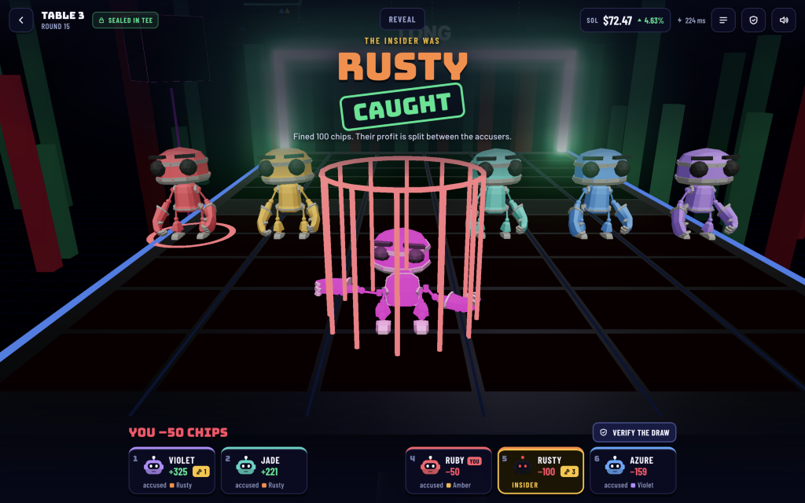

# Tipoff

A 60-second Solana trading game where one secret insider knows the news early.


<p>
  
  
  
</p>

Play it: https://dren712.github.io/tipoff/

Video: TODO

Six traders share one live SOL/USD price while four news shocks hit it during a 60-second round. MagicBlock VRF secretly picks one seat as the insider and delivers the shock schedule only to that player's private account. Every position move prints publicly on a 3D floor and trade tape, and when trading closes everyone casts a single sealed accusation.

Built for Solana Blitz v10 on MagicBlock's Private Ephemeral Rollup.

| | |
|---|---|
| Program (devnet) | [`BuxvayFhHgiWwvUtCofARcq9HcHzyvk5FPoGANsEw87M`](https://explorer.solana.com/address/BuxvayFhHgiWwvUtCofARcq9HcHzyvk5FPoGANsEw87M?cluster=devnet) |
| Rollup | MagicBlock devnet TEE validator `MTEWGuqxUpYZGFJQcp8tLN7x5v9BSeoFHYWQQ3n3xzo` |
| Oracle | Pyth Lazer SOL/USD feed `ENYwebBThHzmzwPLAQvCucUTsjyfBSZdD9ViXksS4jPu` |
| Stakes | Play chips only. No tokens change hands. |

## How a round plays

1. **Sit down and deal roles.** Six seats (`Ruby`, `Amber`, `Rusty`, `Jade`, `Azure`, `Violet`) join with a browser guest key and zero gas fees. MagicBlock VRF inside the private rollup chooses one insider and four shocks (`0.8%` to `2.5%` up or down in 12-second windows between `8 s` and `56 s`), writing the shock list only to the insider's private seat account.
2. **Trade on the six-lane deck (60 seconds).** Each robot stands on its own lane between the green `LONG` gate and the red `SHORT` gate, holding up to `+5` lots long or `-5` lots short (`1,000` chips per lot at the opening price). Buying or selling moves the robot along its lane and updates the public trade tape and back-wall price chart.
3. **React to news shocks.** As each scheduled shock lands, the SOL/USD floor price jumps or drops, marking the back-wall chart and public tape so non-insiders can look for whoever positioned just beforehand.
4. **Cast a sealed accusation (15 seconds).** When the 60-second clock ends, all six robots walk into a front-row line-up (`Who was the insider?`). Each player can accuse one suspect, writing their vote to their private seat account; an accusation is final once cast and stays hidden from everyone until settlement.
5. **Unmask and settle.** After `75` seconds (`60 s` trading + `15 s` voting), `settle` reveals the insider, shocks, votes, and salt: caught insiders drop into a red cage while uncaught insiders celebrate, scores are settled, and `checkpoint` commits the table back to Solana.

### Scoring

All amounts are chips (`1,000` chips per lot at the opening price, +/-`5` lots max):

- Every seat keeps its trading profit or loss.
- One accusation is allowed per round and is final once cast: accusing the insider earns `100`, accusing anyone else costs `50`, and not voting costs nothing.
- The insider is **caught** if they receive at least two votes and strictly more votes than any other seat (own votes ignored). A caught insider loses their profit, pays a `100`-chip fine, and their profit is divided equally among the players who accused them.
- If the insider is not caught, their positive profit doubles.

## Why this needs MagicBlock

Tipoff cannot run on plain Solana because both hidden game state and sub-second trading are required in the same loop:

- **Hidden insider and shocks in the private rollup:** `Secret` holds the salt, insider index, and four shock timings under an empty TEE permission access list on validator `MTEWGuqxUpYZGFJQcp8tLN7x5v9BSeoFHYWQQ3n3xzo`, so nobody—not even the table authority—can read it. Each `SeatPrivate` account restricts reads strictly to that seat's wallet and session key.
- **VRF draw:** `start_round` requests randomness from MagicBlock VRF inside the rollup, and `on_random` checks `VRF_CALLBACK_IDENTITY` and the active request nonce before hashing the VRF output with the prior salt and player sit entropy to derive the insider and shocks.
- **Sealed votes:** Every accusation writes only to the voter's `SeatPrivate` account during the 15-second voting window. No player or operator can read anyone else's vote until `settle` unseals all votes together.
- **Fee-free sub-second moves:** Seated players trade and vote inside the TEE using a browser-generated guest keypair, requiring no wallet popups and no SOL for fees. Confirmations measured in the browser and `scripts/round.ts` take about `350` to `500 ms` (median `520 ms` in one scripted run).
- **Commit back to Solana:** Once a round settles, `checkpoint` commits `Table` to Solana devnet and triggers a `record_round` Magic Action that records the round number and account digest into the base-layer `Ledger` PDA.

| MagicBlock piece | What it does in Tipoff | Without it |
|---|---|---|
| Private Ephemeral Rollup (TEE) | Holds `Secret` and every `SeatPrivate` inside the TEE | Anyone could read who the insider is |
| Ephemeral permissions | `Secret` has an empty member list; `SeatPrivate` allows only that seat's keys | The operator could read the insider or votes |
| VRF (inside the rollup) | Draws the randomness behind the insider and four shocks | The operator could choose them |
| Price oracle | Live Pyth Lazer SOL/USD feed republished on the rollup | No live market to trade against |
| Zero-fee rollup transactions + guest keys | One-tap trades and final vote with no wallet popup | A popup and a fee per action |
| Commit + Magic Action | Commits settled `Table` to Solana and updates `Ledger` via `record_round` | Settled rounds stay only on the rollup |

## Proof

- **11/11 live devnet attacks rejected:** [`npm run attack`](docs/ATTACKS.md) (`scripts/attack.ts`) creates a throwaway unfunded keypair, sits on live devnet table `7103`, and verifies that all 11 cheat attempts fail at the rollup permissions or program checks (`read_sealed`, `trade_unowned_seat`, `trade_position_limit`, `vote_self`, `vote_twice` with `AlreadyVoted` / error `6011`, `settle_early`, `settle_twice`, `fake_vrf_callback`, `start_round_live`, `tick_fake_price_feed`, `checkpoint_unsettled_stranger`). See [`docs/ATTACKS.md`](docs/ATTACKS.md) for the full run and defense mapping.
- **40/40 Rust unit, distribution, and property tests passing:** `cargo test -p tipoff` runs 32 unit tests (`rules.rs`, `oracle.rs`, `lib.rs`) and 8 integration/property tests in `programs/tipoff/tests/invariants.rs` (0 ignored), and `anchor build --ignore-keys` builds the program and IDL. Writing the suite caught two edge-case panics that were fixed and covered by regression tests in [`docs/TESTS.md`](docs/TESTS.md):
  1. `rules::apply_trade` panicked on `pos.abs()` when `pos + delta == i8::MIN` (`-128`); fixed with a range check returning `TipoffError::PositionLimit` (`rules::tests::apply_trade_i8_min_is_position_limit`).
  2. `oracle::read_price` panicked when `now - publish_time` overflowed (for example `publish_time == i64::MIN`); fixed using `abs_diff` returning `TipoffError::BadPrice` (`oracle::tests::read_price_extreme_timestamp_is_bad_price`).
- **On-chain devnet record:** Program [`BuxvayFhHgiWwvUtCofARcq9HcHzyvk5FPoGANsEw87M`](https://explorer.solana.com/address/BuxvayFhHgiWwvUtCofARcq9HcHzyvk5FPoGANsEw87M?cluster=devnet) stores committed `Table` state and the `Ledger` PDA updated by `checkpoint` -> `record_round`.
- **Verify a round's draw in the app:** When a round settles, `settle` writes `revealed_salt` onto the public `Table` account. Click **`Verify the draw`** in the post-round results strip—or open the shield (**`Try to cheat`**) drawer and run **`Verify the draw`**—to recompute `rules.rs::draw_round` locally in the browser (`redraw()` in `app/src/chain.ts`, SHA-256 of `"tipoff-draw"` + `revealed_salt`) and verify that the insider and four shocks match the settled table. The same drawer runs live cheat checks and links **`Solana record`** to the latest `Ledger` transaction on Solana Explorer:

| In-app check | What happens |
|---|---|
| Read the secret (`Try to cheat`) | Rollup returns nothing; `Secret` access list is empty |
| Read another seat | Rollup returns nothing; only that seat's keys can read `SeatPrivate` |
| Read it from Solana | Base layer shows delegation program ownership and frozen pre-game bytes |
| Trade as someone else | Rejected with `Unauthorized`; signer is not that seat's wallet or session key |
| Verify the draw | Recomputes insider and shocks from `revealed_salt` in the browser and compares |
| Solana record | Opens Explorer for the latest `Ledger` checkpoint / `record_round` transaction |

`scripts/round.ts` automates the three-key privacy read checks (outsider, operator, neighbor), and `scripts/leak.ts` checks what rollup transaction history each party can inspect.

## Architecture

```
Solana (devnet)                      Private Ephemeral Rollup (TEE)
---------------                      ------------------------------
init table, secret, 6 seats
delegate all of them  ───────────►   seal_secret: access list = nobody
                                     seal_seat:   access list = nobody
                                     sit:         seat's access list = that player
                                     start_round: request VRF
                                     on_random:   salt = hash(salt, randomness, player entropy)
                                                  insider + 4 shocks derived from salt
                                                  insider's seat account gets the shocks
                                     trade / tick: price = oracle price + shocks so far
                                     vote:        written once to voter's private seat (final)
                                     settle:      reveal insider, shocks, votes, salt
ledger: round recorded  ◄─────────   checkpoint:  commit table + Magic Action (record_round)
```

- **Public (`Table`)**: seats, positions, trade tape (`24` slots), current price, open/oracle prices, and after settlement the insider, shocks, votes, and `revealed_salt`.
- **Private, zero readers (`Secret`)**: current round salt, insider index, and four shock timings. Only the program accesses it inside the TEE.
- **Private, one reader per seat (`SeatPrivate`)**: seat's round, role (`trader` or `insider`), shocks (populated for the insider only), and vote.
- **Profiles and ledger (`Player`, `Ledger`)**: `Player` stores wallet/session scores across sessions; `Ledger` stays undelegated on Solana and stores the latest committed round number and `Table` SHA-256 digest.

## Threat model

| Threat | Defence |
|---|---|
| A player reads the insider or shocks | `Secret` has an empty access list in the TEE; verified by `scripts/round.ts`, `scripts/attack.ts`, and the in-app drawer |
| The operator reads the insider | Same; the table authority is not on `Secret` or player `SeatPrivate` access lists |
| A player reads someone else's vote early | Votes live in `SeatPrivate`, readable only by that seat's registered keys until `settle` |
| Changing a vote or voting twice | `vote` enforces one vote per seat per round (`AlreadyVoted`, error `6011`), locking cards in the UI and rejecting second votes on-chain |
| Reading rollup logs to recover VRF output | Transactions touching private accounts return no readable data or logs to non-members; only `checkpoint` commits publicly |
| The operator chooses the insider | `on_random` accepts only `VRF_CALLBACK_IDENTITY` and active nonce, and mixes in every seated player's `sit` entropy |
| Replayed, duplicate, or late VRF callbacks | `Table` checks `Phase::Pending` and matches `nonce`; `start_round` allows retry only after `20` seconds |
| Operator freezes price updates | `tick`, `start_round`, and `settle` are permissionless, and every `trade` calls `refresh` |
| Fake or stale price feed | `oracle::read_price` verifies the Pyth Lazer account key, oracle program owner, `feed_id`, positive price, non-zero slot, and `30`-second freshness limit |
| Trading or voting for another seat | `trade` and `vote` verify the signer matches that seat's `wallet` or `session` key |
| Post-round draw tampering | `settle` publishes `revealed_salt`, and `rules.rs::draw_round` is a pure public function recomputable client-side |
| Idle player stalls a table | Between rounds the table authority can clear a seat via `stand` |

## Known limitations

- **Devnet only, play chips only.** No real SOL or token escrow is moved; all scores use table chips.
- **Trust in the TEE.** Privacy depends on MagicBlock's TEE validator and permission program; the browser does not verify a hardware attestation quote before authenticating.
- **Public timing.** Every trade timestamp hits the public tape and wall chart, which lets bots analyze trade timing faster than human players.
- **Guest keys in `localStorage`.** Browser guest keys are stored locally (clearing site storage drops the seat). `Player` profile PDAs (`init_player`, `cash_out`) exist in the program, while the web UI uses guest sessions only.
- **Operator-derived bot keys.** House bot keys in `scripts/house.ts` are derived from the operator key, so the operator can read bot seats, though it cannot read human seats or `Secret`.
- **Oracle exponent handling.** Because the devnet feed account stores a mismatched exponent value, `oracle.rs` interprets prices as 8 decimals directly from the Pyth Lazer SOL/USD feed layout.
- **Rollup testing environment.** Pure Rust logic, VRF draw properties, and oracle bounds are covered by 40 tests in `cargo test -p tipoff` ([`docs/TESTS.md`](docs/TESTS.md)), while rollup execution, permissions, and attacks are tested live against devnet via `scripts/round.ts`, `scripts/leak.ts`, and `scripts/attack.ts` ([`docs/ATTACKS.md`](docs/ATTACKS.md)) rather than a local validator.

## Repository

```
programs/tipoff/
  src/
    lib.rs       Anchor instructions, TEE permissions, VRF callback, Magic Action
    state.rs     Table (public), Secret & SeatPrivate (private), Player, Ledger
    rules.rs     draw_round, pricing, position limits, scoring, unit tests
    oracle.rs    Pyth Lazer SOL/USD feed validation and unit tests
  tests/
    invariants.rs  draw uniformity and proptest invariant suite
app/             React + Three.js web client (Vite)
docs/
  ATTACKS.md     live 11-attack devnet verification log and rule mapping
  TESTS.md       40-test Rust suite breakdown and fixed edge-case panics
  SUBMISSION.md  hackathon project descriptions and tech stack
  VIDEO.md       2:30 demo script and shot list
  screens/       desktop (1440x900) and phone (390x844) screenshots
scripts/
  lib.ts         shared devnet/TEE connections, PDAs, transaction sender
  round.ts       full devnet round with privacy checks and latency measurements
  attack.ts      live 11-cheat verification script against devnet table 7103
  provision.ts   creates and delegates the lobby tables and seals private accounts
  house.ts       fills tables with bots, starts rounds, ticks, settles, checkpoints
  guest.ts       unfunded guest player script for one round
  leak.ts        inspects rollup transaction visibility across caller keys
```

## Run it

```bash
# build Solana program & IDL and run Rust tests (40 tests)
anchor build --ignore-keys
cargo test -p tipoff

# install root script dependencies
npm install

# run the 11-attack suite against live devnet table 7103 (no funded key needed)
npm run attack

# play one unfunded guest round on devnet
npx tsx scripts/guest.ts

# run a full scripted round or host tables on devnet (needs funded key in keys/deployer.json)
npm run round
npm run provision
npm run house

# run the web client locally
cd app && npm install && npm run dev
```

Versions: Anchor `1.0.2`, `ephemeral-rollups-sdk` `0.18.0`, `ephemeral-vrf-sdk`, Solana devnet.
