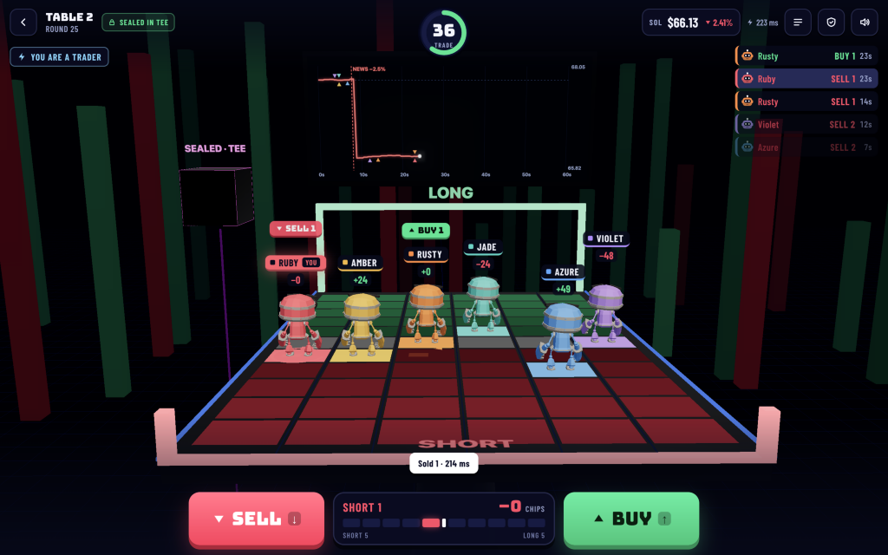
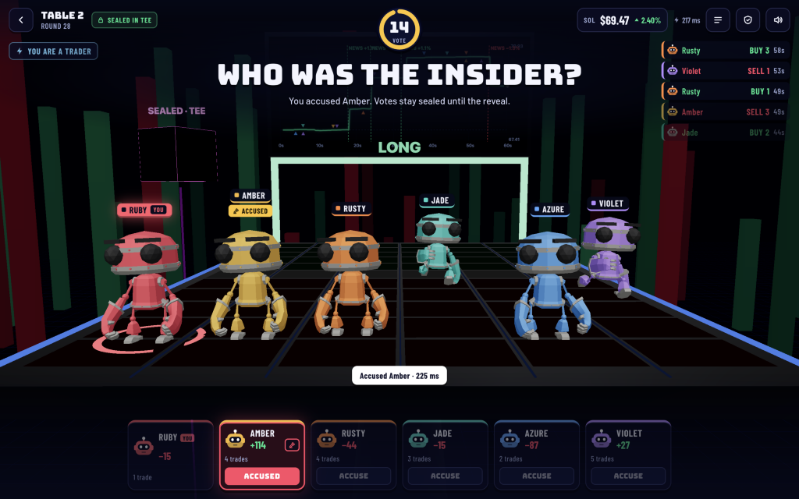
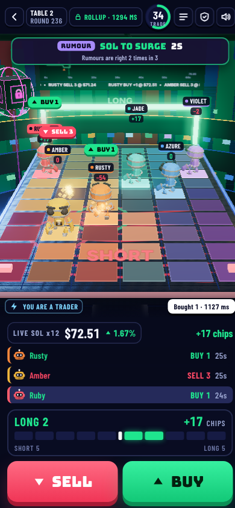

# Tipoff

A 60-second trading game where one of six players secretly knows the news, and everyone else has to work out who.

It only works because the secret stays secret. On a normal blockchain anyone could read the insider and the news schedule straight from the account data. Tipoff runs its rounds inside a MagicBlock private rollup, where nobody can read them, not even the person running the tables.

- **Play now, no wallet needed:** https://dren712.github.io/tipoff/ (connect Phantom or Solflare if you want your season record tied to your wallet)
- **Demo video:** VIDEO_URL_HERE
- **Program on Solana devnet:** [`BuxvayFhHgiWwvUtCofARcq9HcHzyvk5FPoGANsEw87M`](https://explorer.solana.com/address/BuxvayFhHgiWwvUtCofARcq9HcHzyvk5FPoGANsEw87M?cluster=devnet)



<p>
  
  
  
</p>

Built for Solana Blitz v10.

## How a round plays

1. **Sit down.** You get a seat at a six-player table straight from the browser. Empty seats are filled by bots, so a round starts within seconds.
2. **One of you is the insider.** MagicBlock's verifiable randomness picks one player and four news shocks inside the private rollup. Only the insider is told when the shocks land and which way they go.
3. **Trade for 60 seconds.** Everyone trades the same price, which follows the live SOL/USD price at 12x. Tap Buy or Sell to go up to 5 lots long or short. Each trade confirms in about half a second, with no fees and no wallet pop-ups.
4. **Watch for the tells.** Five seconds before each shock a public rumour names a direction. It is right two times in three, and only the insider knows which rumours are lies. The last two shocks are the biggest, and every trade appears on the public tape, so the insider has to profit without being obvious.
5. **Accuse.** When trading ends, you get 15 seconds to cast one sealed vote. The evidence cards show who traded just before each shock. Go all-in if you are sure.
6. **The reveal.** Votes, the insider and the shocks are revealed together. A caught insider goes in the cage; an insider who escapes celebrates. Scores go to the season board on Solana.

### Scoring (play chips)

| | Right | Wrong |
|---|---|---|
| Normal accusation | +100 | -50 |
| All-in accusation | +200 | -150 |

- Everyone keeps their trading profit or loss.
- The insider is **caught** with at least two votes and more votes than anyone else. They lose their profit, which is shared among their accusers, and pay a 100-chip fine.
- An insider who **escapes** doubles their profit. If they made nothing, they pay a 50-chip penalty, so sitting still is not a safe way to hide.
- Human players' results (score, rounds, catches, escapes, streak, best) are kept on the [season board](https://explorer.solana.com/address/5QKFsaj9mwMrejYFtHeBHN9LMTZhbLTM5bt8SwLuAX6d?cluster=devnet) on Solana.

## Why it needs MagicBlock

| The game needs | MagicBlock gives | On plain Solana |
|---|---|---|
| A hidden insider and hidden news | A private rollup running in a secure enclave (TEE). The secret account has nobody on its read list, and each seat's private account can be read only by that seat's own keys | Every account is public, so anyone could read the news and trade on it |
| Sealed votes | Votes are written to each voter's private seat account and only revealed at settlement | Votes would be visible, so players could copy or counter them |
| A fair draw | MagicBlock VRF inside the rollup, mixed with randomness from every seated player. The salt is published at the end so anyone can recheck the draw | The operator could pick the insider |
| Fast trading on a live price | Free transactions in about 0.5 s (median 520 ms in a scripted run), reading the SOL/USD oracle inside the rollup | Every trade would cost a fee and a wallet confirmation |
| A permanent record | Each settled table, round record and the season board are committed back to Solana | Fast moves and a permanent record would need two different systems |

## Proof

- **11 out of 11 cheats rejected on live devnet.** `npm run attack` uses a fresh key with no funds to try reading the secret, reading another seat, trading as someone else, voting twice, voting for yourself, settling early or twice, faking the VRF callback and the price feed, and more. Full run: [docs/ATTACKS.md](docs/ATTACKS.md).
- **51 Rust tests pass**, including statistical tests of the draw and property tests of the scoring rules. Writing them found and fixed two crash bugs. Details: [docs/TESTS.md](docs/TESTS.md).
- **Try it in the game.** The *Try to cheat* button (also opened by clicking the rollup chip) lets you try to read the secret, read another seat or trade as someone else during a live round, and shows each attempt failing. After a round, *Verify the draw* recomputes the insider and shocks in your browser from the published salt.
- **On-chain record:** the [round ledger](https://explorer.solana.com/address/Dx1D48i2W3UTZpnJF1SxocVybbBDT73RjTVHycLvgcAu?cluster=devnet) and [season board](https://explorer.solana.com/address/5QKFsaj9mwMrejYFtHeBHN9LMTZhbLTM5bt8SwLuAX6d?cluster=devnet) on Solana Explorer.

## How it works

```
Solana devnet                          MagicBlock private rollup (TEE)
-------------                          -------------------------------
create table, secret, 6 seats
delegate them to the rollup  ───────►  lock the secret: nobody can read it
                                       sit: a seat becomes readable by its player only
                                       start_round: request VRF
                                       VRF callback: pick insider + 4 shocks,
                                                     tell only the insider
                                       trade / tick: price = SOL/USD x12 + shocks so far
                                       vote: sealed in the voter's private seat
                                       settle: reveal insider, shocks, votes, salt
round ledger + season board  ◄───────  commit back to Solana
```

The round runner (`scripts/house.ts`) keeps the public tables going: it seats bots, starts and settles rounds, and commits results. It runs on GitHub Actions ([`.github/workflows/house.yml`](.github/workflows/house.yml)). Because it uses the same permissions as everyone else, the operator cannot read the secret or human players' seats either.

### Threat model

| Threat | Defence |
|---|---|
| A player or the operator reads the insider or shocks | The secret account has an empty read list inside the TEE |
| A player reads another seat's role or vote | Each seat's private account is readable only by that seat's keys |
| Voting twice or changing a vote | Rejected by the program (`AlreadyVoted`) |
| The operator picks the insider | Only the VRF program can deliver randomness, and it is mixed with every player's entropy; the draw can be rechecked from the published salt |
| Replayed or late randomness | The callback must match the current round's request |
| The operator freezes the price | Price updates and settlement can be called by anyone, and every trade refreshes the price |
| A fake or stale price feed | The oracle account, owner, feed id and a 30-second freshness limit are all checked |
| Trading or voting for someone else | The signer must be that seat's wallet or session key |

### Known limitations

- Devnet only, and play chips only: no real money moves.
- Privacy relies on MagicBlock's TEE validator. The browser does not check a hardware attestation itself.
- Trade times are public by design, so bots can read the tape faster than people.
- Guest keys live in the browser's local storage; clearing it loses the seat.
- The operator derives the bots' keys, so it can read bot seats (never human seats or the secret).
- Rollup behaviour is tested live against devnet (`scripts/round.ts`, `scripts/leak.ts`, `scripts/attack.ts`) rather than on a local validator.

## Repository

```
programs/tipoff/src/
  lib.rs        instructions: tables, seats, rounds, trades, votes, settlement, commits
  state.rs      accounts: public Table, private Secret and seats, Ledger, Board
  rules.rs      the game rules: draw, pricing, position limits, scoring
  oracle.rs     SOL/USD oracle reading and checks
programs/tipoff/tests/
  invariants.rs statistical and property tests
app/src/
  App.tsx       lobby, season board, table list
  Table.tsx     a table: trading, voting, reveal, results
  Scene3D.ts    the 3D trading floor (Three.js)
  chain.ts      talking to the program and the rollup
scripts/
  house.ts      round runner: bots, start, settle, commit
  bots.ts       bot trading and voting decisions (tested in bots.test.ts)
  attack.ts     the 11 live cheat attempts
  round.ts      one scripted round with privacy checks and timings
  leak.ts       checks what rollup transaction data each party can see
  provision.ts  creates and delegates the public tables
  payer.ts      funds the house fee payer inside the rollup
  guest.ts      plays one round with an unfunded key
docs/           attack log, test breakdown, submission text, video script, screenshots
```

## Run it

```bash
# program and tests
anchor build --ignore-keys
cargo test -p tipoff

# scripts (Node 20)
npm install
npm run attack           # 11 cheat attempts on live devnet, no funded key needed
npx tsx scripts/guest.ts # play one round as an unfunded guest
npm run test:bots        # 2,000 simulated bot rounds

# web client
cd app && npm install && npm run dev
```

Running your own tables (`npm run provision`, `npm run house`) needs a funded devnet key in `keys/deployer.json` or the `ADMIN_KEY` environment variable.

Built with Anchor 1.0.2, MagicBlock Ephemeral Rollups SDK 0.18.0, MagicBlock VRF, React, Three.js and Vite. Art and sound credits: [app/public/assets/CREDITS.md](app/public/assets/CREDITS.md).
